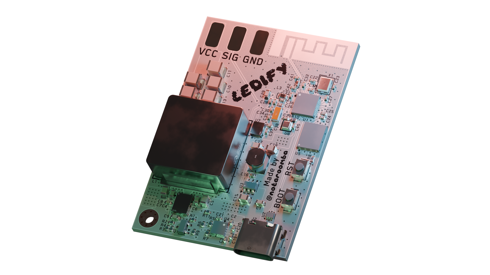
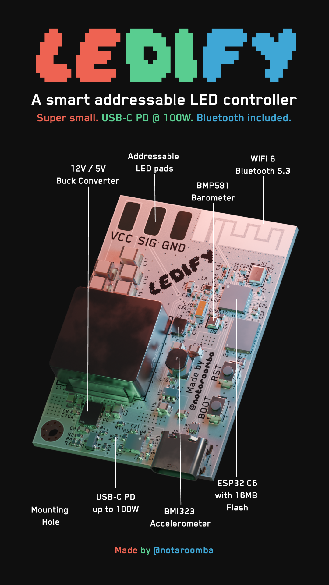
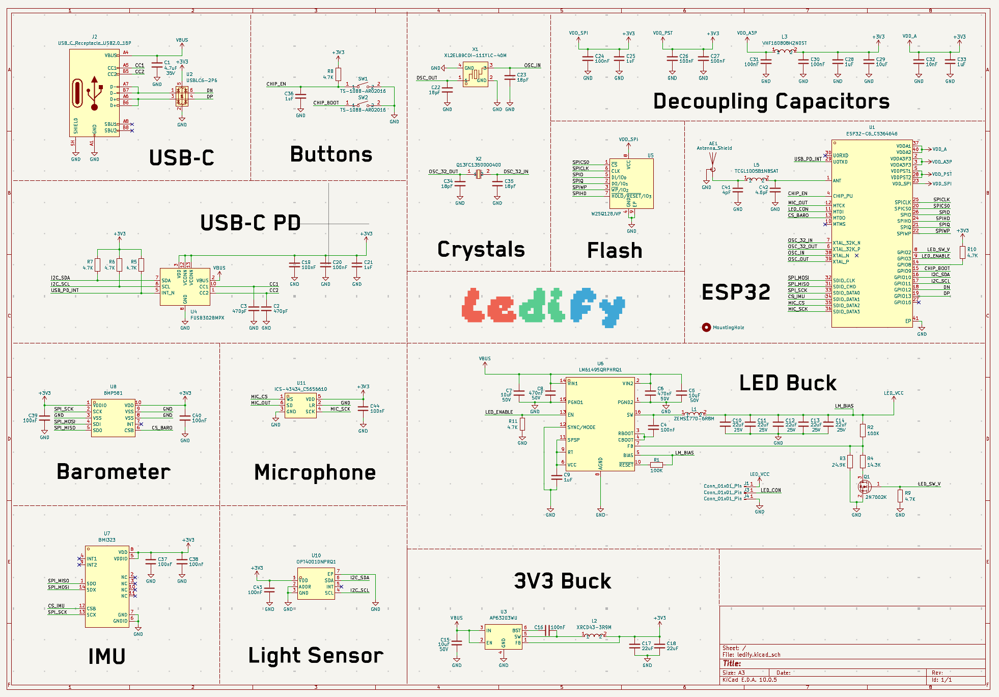
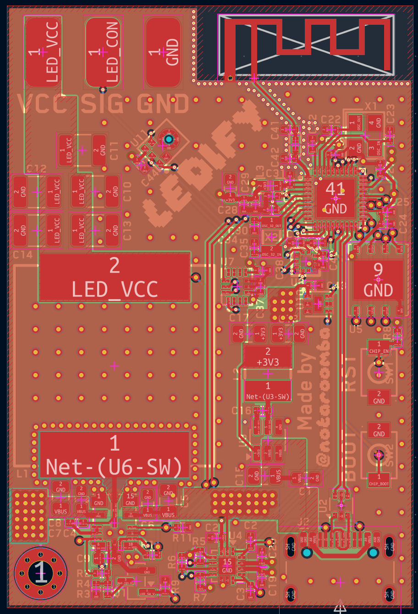
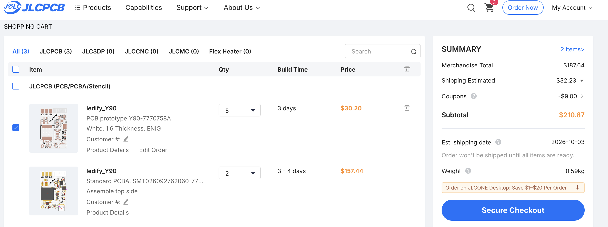

<h1 align="center">
  <br>
  <a href="https://notaroomba.dev"></a>
</h1>

<h4 align="center">
A super small addressable LED controller with USB-C PD up to 100W, a switchable 5V/12V output and Bluetooth!
</h4>

<div align="center">


</div>

<p align="center">
  <a href="#key-features">Key Features</a> •
  <a href="#pcb">PCB</a> •
  <a href="#firmware">Firmware</a> •
  <a href="#credits">Credits</a> •
  <a href="#license">License</a>
</p>



## Key Features

- **ESP32-C6** microcontroller with Wi-Fi 6 and Bluetooth LE
- **16MB flash** (W25Q128JVP)
- **USB-C PD** up to 100W with the FUSB302B
- **Switchable 5V/12V LED output** from a 10A buck converter (LM61495), selected in software
- **Addressable LED pads** (VCC / SIG / GND) for WS2812B, WS2811 and WS2815 strips
- **IMU and Barometer** - BMI323 (6-axis) and BMP581 pressure sensor
- **Ambient light sensor** (OPT4001) for automatic brightness
- **I2S microphone** (ICS-43434) for sound-reactive effects
- **PCB trace antenna** with an impedance matching network
- **3.3V buck converter** (AP63203) for the logic side
- **ESD protection** on the USB data lines
- **Reset and boot buttons** and a mounting hole
- **4-layer PCB** design with optimized RF layout and routing



## PCB

Designed in KiCad with attention to RF design and high current power delivery. The board is 4 layers with a solid ground plane under the ESP32, the flash and the antenna feed, and the LED buck follows the layout in the LM61495 datasheet.

### Schematic



### Layout



### Pinout

| GPIO | Net        | Function                                  |
| ---- | ---------- | ----------------------------------------- |
| 2    | LED_SW_V   | LED voltage select (low = 5V, high = 12V) |
| 3    | LED_ENABLE | LED buck enable                           |
| 5    | LED_CON    | LED data (SIG pad)                        |
| 6    | MIC_OUT    | Microphone I2S data                       |
| 22   | MIC_CS     | Microphone I2S word select                |
| 23   | MIC_SCK    | Microphone I2S bit clock                  |
| 10   | I2C_SDA    | I2C data (FUSB302B, OPT4001)              |
| 11   | I2C_SCL    | I2C clock (FUSB302B, OPT4001)             |
| 16   | USB_PD_INT | FUSB302B interrupt                        |
| 18   | SPI_MISO   | Sensor SPI                                |
| 19   | SPI_MOSI   | Sensor SPI                                |
| 20   | SPI_SCK    | Sensor SPI                                |
| 21   | CS_IMU     | BMI323 chip select                        |
| 7    | CS_BARO    | BMP581 chip select                        |
| 12   | DN         | USB D-                                    |
| 13   | DP         | USB D+                                    |
| 9    | CHIP_BOOT  | Boot button                               |
| 8    | -          | Strapping pin, pulled up to 3V3           |

### JLCPCB Quote



## Firmware

The firmware in [`firmware/`](firmware/) is an ESP-IDF v6.1 project with drivers for everything on the board: USB-PD negotiation on the FUSB302B, the LED strip, the light sensor, IMU, barometer and microphone. It takes the same text commands from three places: the USB serial console, Bluetooth (it advertises as `Ledify` with the Nordic UART service, so nRF Connect or Bluefruit Connect work) and MQTT. Point it at a Wi-Fi network and a broker and it shows up in Home Assistant on its own as a light with four effects plus illuminance, temperature, pressure and sound sensors.

| Command               | Action                                                                 |
| --------------------- | ---------------------------------------------------------------------- |
| `on` / `off`          | LED buck on or off                                                     |
| `rgb R G B`           | Fills the strip with a color (0-255 each)                              |
| `level N`             | Brightness cap (0-255)                                                 |
| `count N`             | How many pixels to drive                                               |
| `type ws2812`         | Chip type: `ws2812` (B/C/D/E, WS2813, WS2815), `ws2811`, `sk6812`, `sk6812w`, `ws2816` |
| `mode solid`          | Holds the color                                                        |
| `mode rainbow`        | Animated rainbow                                                       |
| `mode sound`          | Brightness follows the microphone                                      |
| `mode auto`           | Brightness follows the ambient light sensor                            |
| `volt 5` / `volt 12`  | Selects the output voltage, turns the output off first. 12V needs a 15V+ PD contract |
| `status`              | JSON with the PD contract, network state, lux, temperature, pressure, motion and sound level |
| `pd` / `net`          | The charger's offered voltages / Wi-Fi and MQTT state                  |
| `wifi SSID PASS`      | Saves the Wi-Fi credentials and restarts                               |
| `mqtt URL USER PASS`  | Saves the broker and restarts                                          |

The output always boots at 5V and off, and the board asks the charger for the highest voltage up to 20V as soon as it starts. Credentials, the strip length and the chip type are stored in the ESP32's NVS partition, never in the code. SIG is 3.3V logic going to the strip's DIN; the wiring notes, MQTT topics and the Mosquitto-on-Railway broker setup are in [`firmware/README.md`](firmware/README.md).

### Building and flashing

```bash
cd firmware
source ~/.espressif/tools/activate_idf_v6.1.sh
idf.py build
idf.py -p /dev/cu.usbmodem2101 flash monitor
```

## Credits

This project uses:

- [KiCad](https://www.kicad.org/)
- [Blender](https://www.blender.org/) for 3D renders
- [MicroPython](https://micropython.org/)

## You may also like...

- [Cyberboard](https://github.com/NotARoomba/cyberboard) – A Raspberry Pi Pico-sized STM32 development board
- [CyberCard](https://github.com/NotARoomba/CyberCard) – A Cyberpunk themed NFC hacker card
- [Ember](https://github.com/NotARoomba/ember) – USB-C PD Powered Hotplate
- [Trace](https://github.com/NotARoomba/trace) – An ruler for engineers
- [Athena](https://github.com/NotARoomba/athena) – A flight controlelr with a triple MCU architecture

## License

MIT

---

> [notaroomba.dev](https://notaroomba.dev) &nbsp;&middot;&nbsp;
> GitHub [@NotARoomba](https://github.com/NotARoomba) &nbsp;&middot;&nbsp;
